# MicrogliaMorphology2

#### *An updated version of the ImageJ macros for microglia morphology analysis*

MicrogliaMorphology is a set of ImageJ/Fiji macros that offer a semi-automated approach to characterize 40 morphology features from hundreds to thousands of individual microglia.
This is a modified version of [MicrogliaMorphology](https://github.com/ciernialab/MicrogliaMorphology) with several changes. It is more stable on big datasets that crashed the original pipeline, it can run on multiple regions per image, and it can quantify the intensity of another channel within the microglia. The output measurements are slightly different, so if you want to replicate the original data, please refer to the original GitHub.
The former FracLac analysis had a memory leak that caused problems beyond roughly 20,000 cells. FracLac is no longer used and individual image files are no longer created for every cell, which decreases the file load.

**Created**: 21 January, 2026 **Last updated**: 18 Oct, 2026

   ## Citation

If you are using this tool, please cite the following publication:

- [Development of a high-throughput pipeline to characterize microglia morphological states at a single-cell resolution](https://www.eneuro.org/content/11/7/ENEURO.0014-24.2024)

> Kim J, Pavlidis P, Ciernia AV. Development of a High-Throughput Pipeline to Characterize Microglia Morphological States at a Single-Cell Resolution. eNeuro. 2024 Jul 30;11(7):ENEURO.0014-24.2024. doi: 10.1523/ENEURO.0014-24.2024. PMID: 39029952; PMCID: PMC11289588.

---

## Overview: the workflow at a glance

Run the macros in the order below. Each one is found in Fiji under *Plugins > MicrogliaMorphology*. Open the dropdown under each step for the details.

| Step | Macro | What you do | What you get |
| ---- | ----- | ----------- | ------------ |
| 0 | **Install** | Install Fiji and copy the macros into the Fiji plugins folder | Macros appear in the Plugins menu |
| 1 | **TestImageSettingsPicker** | Open a test image, place a test box and click every microglia in it | About 93 options tested and ranked, a Top 20 montage and csv, and the settings to use for your dataset |
| 2 | **MicrogliaMorphologyProgram 2.3** | Pick the Picker's option from a list (or paste its name) and run on the whole dataset | Thresholded masks, split masks and one measurement .csv per image |
| 3 | **Cluster in R** | Run [MicrogliaMorphologyR](https://github.com/ciernialab/MicrogliaMorphologyR) on the measurement files | Morphological clusters and a ColorByCluster label file per image |
| 4 | **CBC (ColorByCluster)** | Point the macro at the original images, final masks and cluster label files | Original images with every microglia colored by its cluster |
| Optional | **CountMicroglia** | Run on Iba1 + DAPI images | Microglia counts and densities per region |

**Before you start: name your images with metadata.** When generating the single-channel .tiff images that contain the microglia, include the important metadata in the file name, with each descriptor separated by an underscore, for example `CohortName_AnimalID_Condition_Sex_BrainRegion.tiff`. This format is important for compatibility with [MicrogliaMorphologyR](https://github.com/ciernialab/MicrogliaMorphologyR).

**Set the pixel size in microns.** Area filters, local threshold radii and soma seed sizes are all in microns. The macros read the pixel size from the image and ask you to confirm it. If an image has no calibration you will be asked to enter it (*Analyze > Set Scale*).

   ## Optional: tracing regions of interest (ROIs)

If you are interested in specific regions within your images, trace them in ImageJ before running the Program. [ROIMAPer](https://github.com/ciernialab/ROIMAPer) is one tool that aligns your brain images to the [Allen Brain Institute reference mouse brain atlas](https://mouse.brain-map.org/static/atlas). You can also trace ROIs manually.

- Name the ROIs and save your .tif files so that they include the ROIs.
- In the Program, tick **"Do your images have ROIs traced?"**. Only the part of each image inside the ROIs is then measured.
- TestImageSettingsPicker does not use traced ROIs. It analyzes the test box you place in the whole image.

---

## Step 0. Installation

**In short:** install Fiji and BioVoxxel Toolbox, copy the macro files into a new `MicrogliaMorphology` folder inside `Fiji.app/scripts/Plugins`, and restart Fiji.

   ### Installation details

#### Install Fiji and the required plugins

- [FIJI/ImageJ](https://imagej.net/software/fiji/?Downloads)
- [BioVoxxel Toolbox](https://imagej.net/plugins/biovoxxel-toolbox)

Within Fiji, the Program also uses the Auto Threshold, Auto Local Threshold and Tubeness plugins, and Skeletonize (2D/3D). These are included in a standard Fiji install. MorphoLibJ is optional (the Close- step falls back to a standard method if it is absent).

#### Install the MicrogliaMorphology macros

1.  When you download and install Fiji, the app and its scripts/plugins are saved in a folder called "Fiji.app". Create a new directory called "MicrogliaMorphology" under: Fiji.app > scripts > Plugins.

2.  Save the following files from this repo (macros-scripts folder) into the new MicrogliaMorphology directory:

- **MicrogliaMorphology_TestImageSettingsPicker_v13.ijm**
- **MicrogliaMorphology_Program2.3.ijm**
- **MicrogliaMorphology_ColorByCluster.ijm**
- **MicrogliaMorphology_CountMicroglia_v1.ijm** (optional)

3.  Restart Fiji.

4.  MicrogliaMorphology should now appear under Plugins (at the bottom of the drop-down). Click a macro to start its prompts. Use them in the order listed above.

---

## Step 1. TestImageSettingsPicker

**In short:** open a representative single-channel test image, run *Plugins > MicrogliaMorphology > MicrogliaMorphology TestImageSettingsPicker*, place the test box, click every microglia inside it, and wait (about 60 minutes for a 2000 x 2000 px image). The macro runs about 93 options, counts how many of your marked cells each one recovers whole, and saves a ranked list (`AllOptions_Ranked.csv`), the best 20 (`Top20_Options.csv`) and a montage of those 20 (`Top20_Montage.png`) that starts with your original image. Check the top options by eye and use the best one in Step 2.

   ### TestImageSettingsPicker details

#### Procedure

1.  Open a representative test image (if none is open, you are asked for a file).
2.  Run the macro. In the first dialog set:
    - **Splitting touching cells:** compare both no split and soma-seeded split (recommended), soma-seeded split only, or no splitting only.
    - **Compare seed settings** (optional): tests seed blur sigma 3 vs 2 um and prominence 8 vs 12 for the lead option.
    - **Colour every kept particle differently** (recommended): each particle in the panels gets its own colour, so cuts and merged cells are easy to see.
    - **Minimum area filter(s) in um^2:** comma separated (default 50,100). Leave it blank to use 50, 100, 130 and 150.
    - **Microglia channel**, **test box size**, **panel size**, **montage columns**, and an optional **quick test** that processes only the central N x N pixels (shortens the run on large images, since Tubeness is slow).
    - **Pruning check:** the percentage used to decide that a cell is complete (default 60, see below).

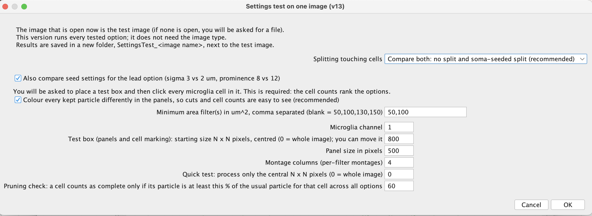

3.  Confirm the pixel size when asked. If it is wrong, untick the box and enter the correct pixel width in microns. The value is used for every image in the run and the image file is not changed.

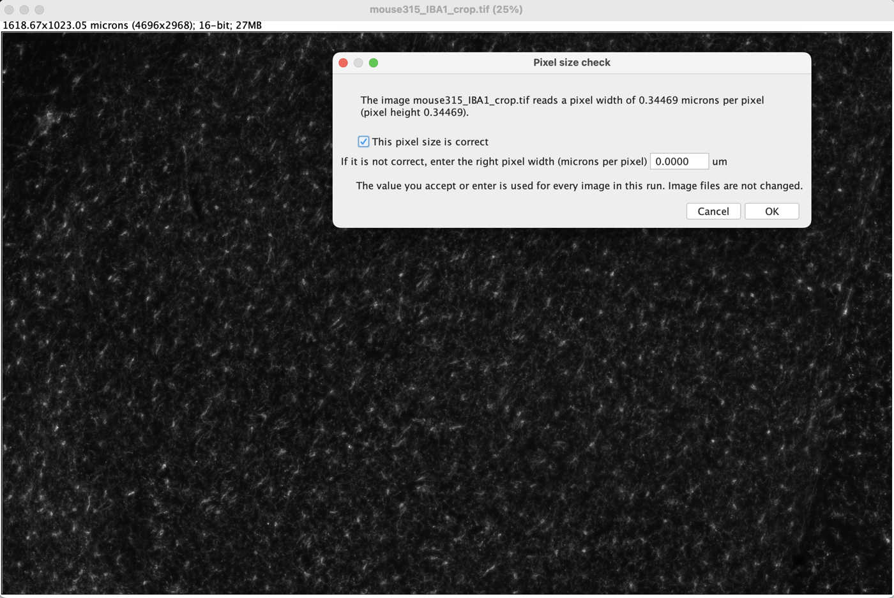

4.  **Place the test box:** drag the yellow box to a representative area of tissue (drag inside it to move, drag a handle to resize) and click OK. The montage panels and the cell/non-cell counts use this box.

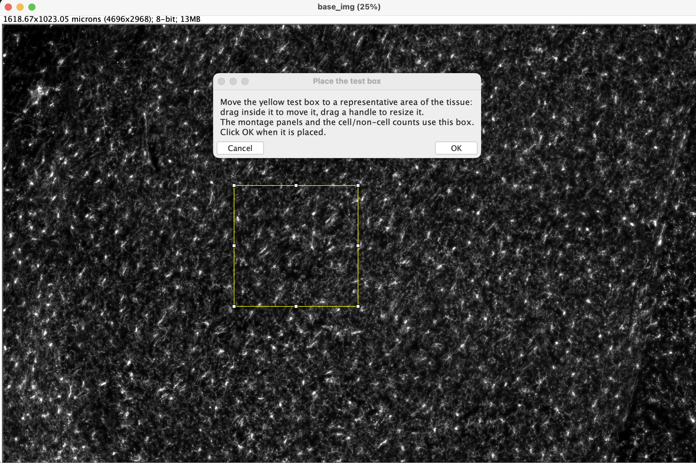

5.  **Mark the cells:** click on the cell body of EVERY microglia inside the box with the multi-point tool (Alt-click removes a point), then click OK. Cells you skip are counted as non-cell particles.

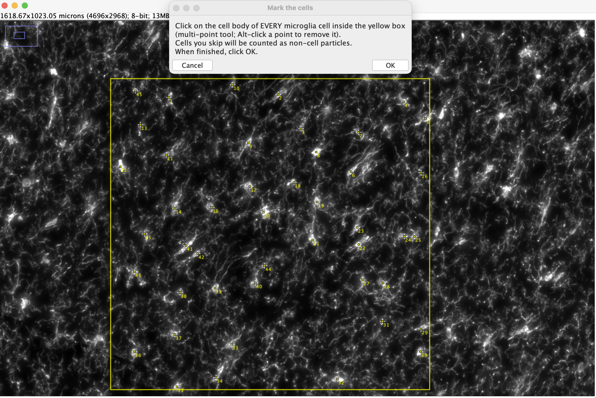

6.  Wait for the run to finish. The Top 20 montage opens when done.

#### Options compared

Option names follow the pattern `C<contrast stretch>U<unsharp mask>D<despeckle>[_<background removal>]_<method>[_<splitting>]`, where 1 is on and 0 is off. For example, `C0U1D1_auto_Huang` is Program 2 standard preprocessing (unsharp mask radius 3, weight 0.6, plus despeckle, no contrast stretch) followed by a global Huang threshold.

- Global thresholds: Huang, Li
- Local thresholds: Niblack, Mean, Phansalkar (radius 100 px at 0.3447 um/px, rescaled to your pixel size)
- Hysteresis: local low threshold plus a global Otsu high mask
- Tubeness ridge filter: TubeOrig and Tube3Post at fixed minimum responses, or noise-relative cutoffs written as `k5`. Tubeness options are not combined with background removal
- Background removal before the other preprocessing: rolling ball (RB), sliding paraboloid (SP), white top-hat (TH), sizes in um
- Splitting: no suffix (unsplit), `_splitSoma` (soma-seeded split, default seed sigma 3 um and prominence 8), `_splitSoma_seedReq` (split plus the seed requirement). A non-default seed is written `_splitSoma_s2.0_p12`

#### How to read the montage panels

Colors in each panel:

- **Each kept particle has its own color** (when the colour option is ticked), otherwise white
- **Black dots with a white ring:** the cells you marked
- **Red:** particle removed (too small)
- **Cyan:** particle removed (too big)
- **Yellow:** line where touching cells were cut

Look for ramified cells that are whole with their processes present, few non-cell particles in the background, touching cells that are separated, and thin branches that are not lost.

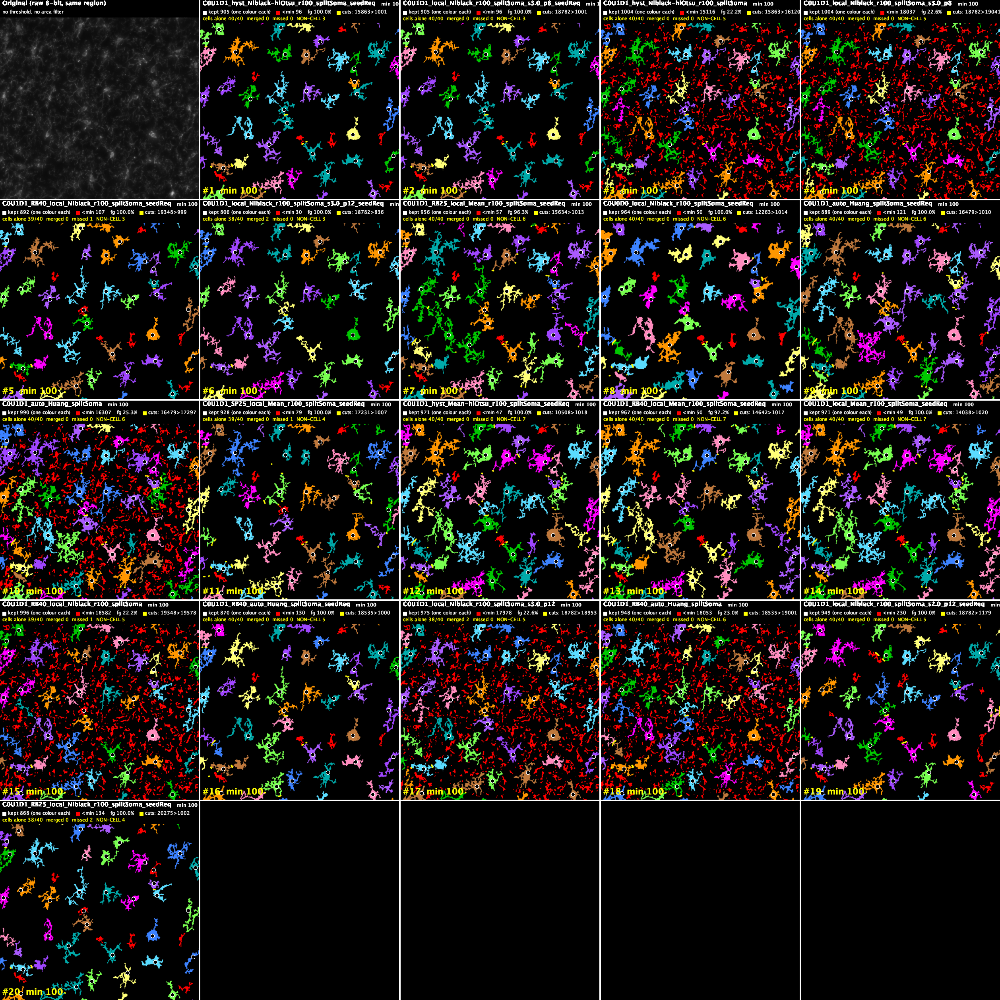

#### How the options are ranked

For every option and area filter, the macro counts inside the test box:

| Column | Meaning |
| ------ | ------- |
| Cells_marked | Number of cells you marked |
| Cells_recovered_alone | Marked cells found as their own particle |
| Cells_complete_alone | Marked cells recovered alone whose particle is not over-pruned (see below) |
| Median_completeness_pct | Median size of the particles of the marked cells, as a percentage of the typical particle for those cells across all options |
| Cells_in_merged_particles | Marked cells found, but fused with another cell in one particle |
| Cells_missed | Marked cells not found |
| Non_cell_particles | Particles kept that do not contain a marked cell |

**Net score = Cells_complete_alone minus Non_cell_particles.** The list is sorted by this score. An option appears once in `Top20_Options.csv`, at its best area filter. `AllOptions_Ranked.csv` lists every option at every area filter.

#### The pruning check

Counting a cell as recovered when its particle contains the marked soma rewards options that keep the soma but cut off the branches (tight local thresholds such as Phansalkar are the usual example). To catch this, the macro takes the area of the particle containing each marked cell and compares it with the median of that cell's particle areas across all options. An option only gets credit for a cell if its particle is at least the **pruning check percentage** of that typical area (default 60). The per-cell areas are saved in `MarkedCellAreas.csv`.

The 60% default is a rule of thumb, not a validated cutoff. In one test run the particle sizes showed a gap between 55% and 65%, but check your own data: look at `Median_completeness_pct` in the ranked list and at the Top 20 montage, and raise or lower the percentage if good options are dropped or pruned options still rank high. Because the check is relative to the other options, it works best when the option list includes some options that keep the full branches.

#### Output

Outputs are saved in a new folder next to the image, `SettingsTest_<image>/`:

| File | Contents |
| ---- | -------- |
| `Top20_Options.csv` | The best 20 options with their counts and net score |
| `Top20_Montage.png` | Review panels of those options in rank order, starting with the original image. Rank and area filter are written on each panel |
| `AllOptions_Ranked.csv` | Every option at every area filter, ranked by the net score |
| `SettingsTest_Summary.csv` | Counts for every option and area filter, including the completeness columns and the background removal, `Seed_required` and `Particles_removed_no_seed` columns |
| `MarkedCellAreas.csv` | Area of the particle that contains each marked cell, for every option |
| `ReviewMontage_<image>_ALL.png` | Rows are options, columns are minimum area filters |
| `ReviewMontage_<image>_min<..>.png` | One montage per filter, first tile is the raw image |
| `SettingsKey.txt` | Tile number mapped to the exact settings of every option |
| `PreprocessBenchmark_Results.csv` | Particle counts and other metrics for each option and filter |
| `Masks/<option>/` | The binary mask of every option |

**Write down the full option name from `Top20_Options.csv`, and its `Min_area_um2`.** You will enter them in Step 2.

---

## Step 2. MicrogliaMorphologyProgram

**In short:** run *Plugins > MicrogliaMorphology > MicrogliaMorphology Program2.3* on the whole dataset. It has three steps: (1) preprocess and threshold, (2) split touching cells, (3) measure single cells. Run all three in one go, or start and stop at any of them. Choose the option you picked in Step 1 from the list, or paste its name, and the Program sets the preprocessing, threshold and splitting for you.

   ### Program details: dialogs and settings

The screenshots below are from Program 2.2 and show the manual dialogs, filled in with the example option `C0U1D1_local_Niblack_r100_splitSoma_s2.0_p8` and a 100 um^2 lower area filter. In Program 2.3 the same settings can be filled in automatically from the Picker option (next section).

#### First dialog: where to start and stop

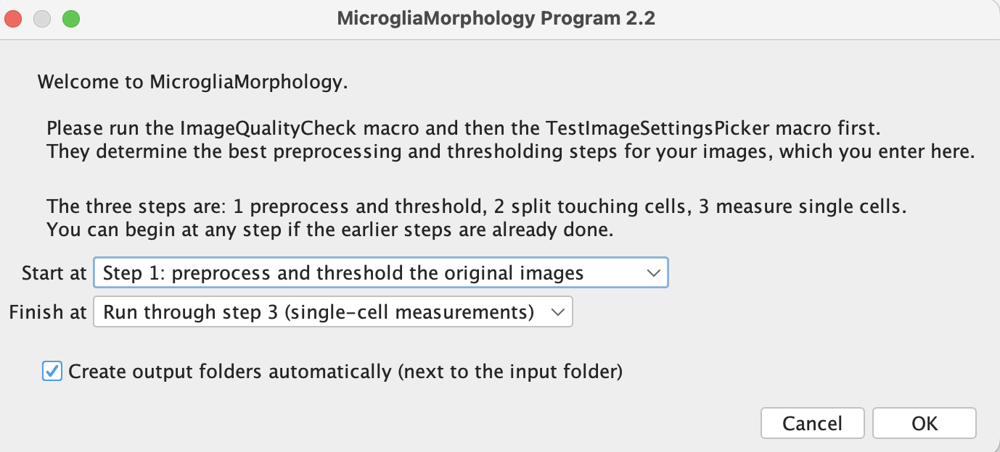

- **Start at / Finish at:** choose the first and last of the three steps. You can begin at step 2 or 3 if the earlier steps are already done.
- **Create output folders automatically:** creates `ThresholdedImages`, `SplitImages` and `MeasurementResults` next to the input folder. If unticked you are asked to choose each output folder (they should be empty).

#### Settings from the TestImageSettingsPicker

If you start at step 1 or 2, a second dialog asks for the settings. You can choose them in one of two ways:

- **Pick from the lists:** choose one of the Picker's 31 base options, then a splitting variant: soma-seeded split + seed requirement (`_splitSoma_seedReq`, the default), soma-seeded split (`_splitSoma`), or no splitting.
- **Paste the option name:** copy it from `Top20_Options.csv` or `AllOptions_Ranked.csv`, for example `C0U1D1_RB25_local_Mean_r100_splitSoma_seedReq`. A pasted name overrides the lists and also reads non-default seed settings, for example `C0U1D1_local_Niblack_r100_splitSoma_s2.0_p12_seedReq`.

The option sets the preprocessing, background removal, threshold or Tubeness variant, splitting and seed requirement for steps 1 and 2. The preprocessing, segmentation and splitting dialogs are then skipped, and the only extra question is the microglia channel. The arm names and the settings file use the same names as the Picker, so the run matches what you ranked. If the name is not understood, the macro stops with a message. If you start at step 2 and pick an option with no splitting and no seed requirement, it stops too, because there is nothing to do at that step.

To set everything yourself, choose "(set every option myself in the next dialogs)" in the list. The dialogs below then appear as before.

**The area filter is not taken from the option name.** Enter the Picker's best `Min_area_um2` in the area filter dialog in step 3. A reminder is shown there.

Program 2.3's own dialogs still let you choose any global high threshold for hysteresis. The Picker's hysteresis options always use an Otsu high mask.

#### Step 1 settings: preprocessing and thresholding (manual option only)

Step 1 has two dialogs: 1a (preprocessing) and 1b (segmentation). They appear only when you do not choose a Picker option.

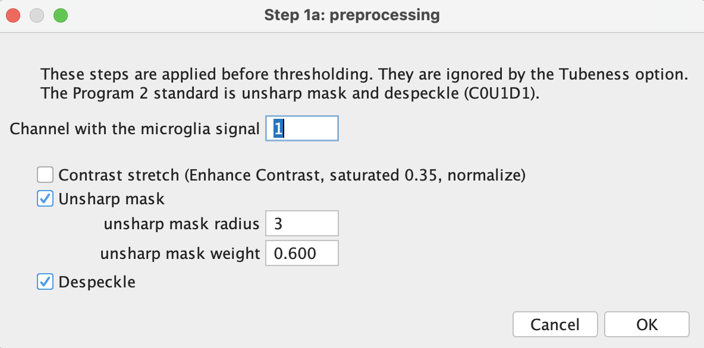

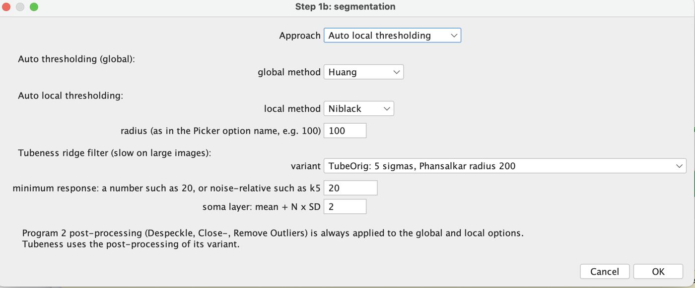

- **Channel with the microglia signal** (leave at 1 for a single channel; the channel order must be consistent across images).
- **Preprocessing:** contrast stretch, unsharp mask (radius and weight) and despeckle, each on or off. The Program 2 standard is unsharp mask plus despeckle (C0U1D1).
- **Segmentation approach:** auto thresholding (global), auto local thresholding, or Tubeness ridge filter.
  - Global: choose the method (for example Huang).
  - Local: choose the method (for example Niblack) and the radius as written in the Picker option name (for example 100).
  - Tubeness: choose the variant, the minimum response (a number such as 20, or noise-relative such as k5) and the soma layer (mean + N x SD).
- Program 2 post-processing (Despeckle, Close-, Remove Outliers) is always applied to global and local options. Tubeness uses the post-processing of its variant.

#### Step 2 settings: splitting touching cells (manual option only)

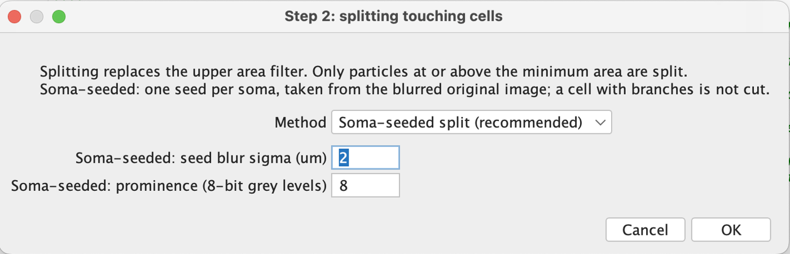

- **No splitting** or **Soma-seeded split (recommended).** One seed is placed per soma from the blurred original image and the mask is cut along watershed lines between seeds. A cell with branches is not cut.
- **Seed blur sigma (um)** (default 3) and **prominence** in 8-bit grey levels (default 8).
- Splitting replaces the old upper area filter. Only particles at or above the minimum area are split.

#### Step 3 settings: area filters and measurements

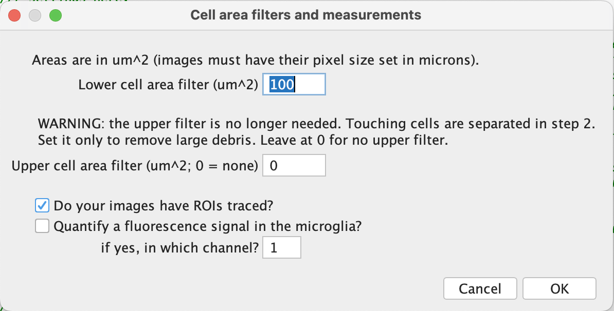

- **Lower cell area filter (um^2):** removes small non-cell particles (default 100). Use the `Min_area_um2` of the Picker option you chose.
- **Upper cell area filter (um^2, 0 = none):** no longer needed because touching cells are separated in step 2. Set it only to remove large debris.
- **Do your images have ROIs traced?**
- **Quantify a fluorescence signal in the microglia?** and which channel. This can be used to compare morphology between stain-positive and stain-negative cells. The channel can be the microglia channel. If you start at step 3, you are asked for the original images again to read this channel.

#### Summary of your settings

A summary of your settings is shown before the folders are chosen. Check it against the option you picked in the TestImageSettingsPicker, and check that the lower area filter matches the Picker's `Min_area_um2`.

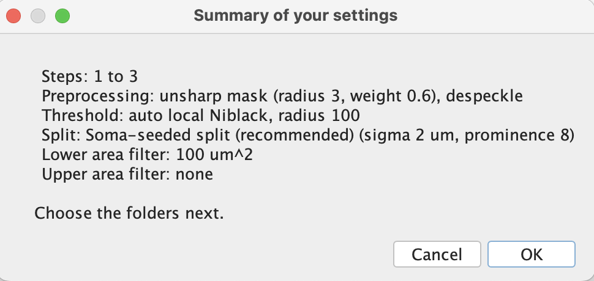

#### Folders and image range

Choose the input folder (original images when starting at step 1; thresholded masks plus original images when starting at step 2; final masks when starting at step 3). Then choose which range of images to process. Files are sorted alphabetically, so "Test_image_1.tif", "Test_image_10.tif" and "Test_image_9.tif" are listed in that order.

#### Pixel size check

Before the run starts, the macro reports the pixel size it reads from the first image and asks you to confirm it. If it is wrong, untick the box and enter the correct pixel width in microns. The value is used for every image in the run.

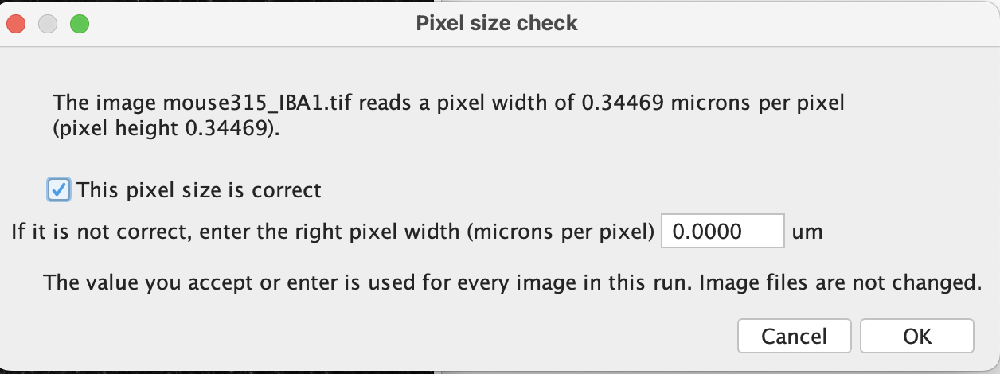

   ### Program details: outputs

All outputs are placed next to the input folder.

| Output | Description |
| ------ | ----------- |
| `ThresholdedImages/<image>_thresholded.tif` | Step 1 masks |
| `SplitImages/<image>_thresholded.tif` | Step 2 masks with touching cells separated |
| `MeasurementResults/<image>.csv` | Step 3: one .csv per input image with one row per cell |
| `Areas.csv` | Area of each image (or of the ROIs within it). Use it in MicrogliaMorphologyR to calculate density (cells / area analyzed) |
| `SplitLog.csv` | Record of the splitting step |
| `FinalDatasetParameters_<date-time>.txt` | Every setting used in the run, for your records. Keep it with your data |

Each row of a measurement file is one cell, with these columns:

|Output | Description |
| ----- | ----------- |
| Label | The name of the individual ROI, sometimes fused to the image and region name |
| Image | The image name |
| Region | The region name. If no region was present or "Do your input images have ROIs" was unselected this says "full_brain" |
| Area | Area of the cell |
| Optional: Mean, Min, Max, IntDen | The mean, minimum, maximum and integrated density of the grey intensity in the quantification channel, when quantification was ticked |
| Perim. | Perimeter of the cell |
| Major | Major radius of the fit ellipse |
| Minor | Minor radius of the fit ellipse |
| Circ. | Circularity, the relationship between area and perimeter of the cell |
| Feret | The major Feret's caliper of the cell |
| MinFeret | The minor Feret's caliper of the cell |
| Round | The roundness of the cell |
| Solidity | The solidity of the cell |
| hull_X | The same measure but applied to the convex hull of the cell |
| Hull span ratio | The ratio between the major and the minor Feret's caliper of the convex hull |
| Max/min radii from hull | The ratio between the maximum radius of the convex hull and the smallest radius of the convex hull. Radius is taken to the center of mass of the convex hull |
| Relative variation (CV) hull | The coefficient of variation (CV) of all long radii (distance from center of mass to corners of convex hull) and all short radii (distance from center of mass to closest point on edge of convex hull) |
| skeleton_X | Results from the Analyze Skeleton function |

---

## Step 3. Cluster the cells in R with MicrogliaMorphologyR

**In short:** use the measurement .csv files and `Areas.csv` as input to [MicrogliaMorphologyR](https://github.com/ciernialab/MicrogliaMorphologyR). It clusters the microglia into distinct morphological states and produces the label files that CBC needs.

   ### MicrogliaMorphologyR details

Available at [github.com/ciernialab/MicrogliaMorphologyR](https://github.com/ciernialab/MicrogliaMorphologyR). For the MicrogliaMorphology Pipeline 2 workflow example, see the [Pipeline 2 tutorial](https://ciernialab.github.io/MicrogliaMorphologyR/articles/MicrogliaMorphologyPipeline2.html). One of its outputs is a set of ColorByCluster label files, which provide the information used to color the original microglia by cluster in Step 4.

---

## Step 4. CBC (ColorByCluster)

**In short:** run *Plugins > MicrogliaMorphology > MicrogliaMorphology ColorByCluster*, choose the folders of original images, final masks and cluster label files, pick a color for each cluster, and the macro saves the original images with each microglia colored by its cluster.

   ### ColorByCluster details

ColorByCluster lets you color the microglia in your original immunofluorescent images by their cluster identities. It is the companion to the output of MicrogliaMorphologyR (see the [ColorByCluster section](https://ciernialab.github.io/MicrogliaMorphologyR/articles/MicrogliaMorphologyPipeline2.html) of that repo) and is a way to visually validate morphological clusters and see their spatial distribution in the brain. It colors one image at a time or batch processes a group of images.

#### You will need

- The original immunofluorescent .tiff image(s) that were input into MicrogliaMorphology.
- The final mask .tiff image(s) that were measured, with the original image name as the starting string (the .tif extension is not needed). Use the images from `SplitImages` if you split touching cells, so that the cell IDs match the label files.
- The ColorByCluster labels .csv file(s) generated using [MicrogliaMorphologyR](https://github.com/ciernialab/MicrogliaMorphologyR#colorbycluster), with the corresponding original image name as the starting string.

All three sets of files must have the same starting string, ideally the name of the original image.

#### Label file format

A column with an empty first row and ascending numbers after that; a column named "Cluster"; a column named "ID" with content matching the single-cell ROI labels; and a column named "Region" with names matching the analyzed regions, or "full_brain" if no regions were provided:

|   | Cluster | ID | Region |
| - | -------- | --- | ------ |
| 1 | 2 | 0001-0034 | Region1 |
| 2 | 1 | 0001-0026 | Region2 |
| 3 | 1 | 0002-0193 | Region2 |
| 4 | 3 | 0003-0351 | Region2 |
| 5 | 1 | 0001-0039 | Region3 |
| 6 | 3 | 0002-0062 | Region3 |
| 7 | 2 | 0003-0175 | full_brain |
| 8 | 2 | 0004-0290 | full_brain |

#### Procedure

1.  Choose the parent folder of the original images, the folder of final masks, and the folder of cluster label .csv files.
2.  Choose an output folder for the colored images.
3.  Choose the channel to color (leave at 1 for a single channel).
4.  Set a color for each cluster (up to 10). Use a HEX code such as `BBCC33`, or one of: black, white, cyan, magenta, yellow, red, green, blue, orange.

Output: `<image>_ColorByCluster.tif` for every original image that has both a matching mask and a matching label file.

---

## Optional: CountMicroglia

**In short:** run *Plugins > MicrogliaMorphology > MicrogliaMorphology CountMicroglia v1* on multi-channel images with a microglia stain (Iba1) and a nuclear stain (DAPI). Each DAPI nucleus is counted as a microglia when it sits inside or touches an Iba1 cell body. Counts, area and density (cells/mm^2) are reported per region.

**Recommended workflow:** tune the settings on one test image first, then run the batch.

1.  Open one representative multi-channel image and run the macro in **single image** mode with **"Mark cells now"** validation. Click once on every microglia you can identify.
2.  Check the QC image, the two mask images and the validation numbers (TP, FP, FN, precision, recall, F1).
3.  Change one setting at a time (see the tuning guide below), re-run on the same image, and keep the settings that give the best F1.
4.  Confirm the settings on two or three more images from different animals, conditions or regions.
5.  Run **batch** mode on the whole folder with validation turned off.

   ### CountMicroglia details: running the macro

#### Input

A multi-channel TIF (hyperstack). Z-stacks are max projected per channel. The pixel size is read from the image calibration. If there is none, the fallback value from the dialog is used, or you are asked.

#### First dialog

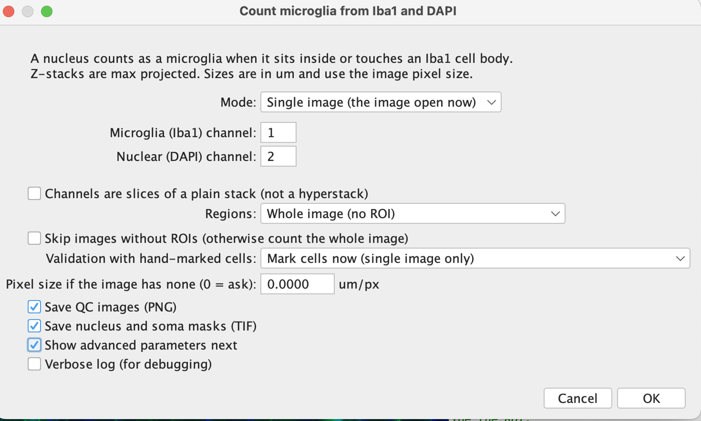

- **Mode:** single image (uses the open image; drawing ROIs and marking cells are available) or batch (every .tif/.tiff in a folder; results go to a subfolder `CountMicroglia_output`).
- **Microglia (Iba1) channel** and **Nuclear (DAPI) channel**. Tick the box if the channels are slices of a plain stack rather than a hyperstack.
- **Regions:** whole image, ROIs saved in the TIF (selection and/or overlay), an ROI .zip next to the image (`NAME.zip`, `NAME_RoiSet.zip`, `NAME_ROI.zip`, `NAME_ROIs.zip` or `RoiSet.zip`), or ROIs drawn now (single image mode). Choose whether to skip images without ROIs or count the whole image. A nucleus belongs to an ROI when its centroid lies inside it. Segmentation is done on the whole image, so thresholds do not depend on the ROI.
- **Validation with hand-marked cells:** none, existing marks, or mark cells now (single image only).
- **Pixel size** if the image has none (0 = ask).
- **Save QC images (PNG)** and **Save nucleus and soma masks (TIF)**. Keep both ticked while tuning.
- **Show advanced parameters next** opens the second dialog (tick it while tuning).
- **Verbose log** for debugging.

#### Advanced parameters

All sizes are in microns and use the image pixel size.

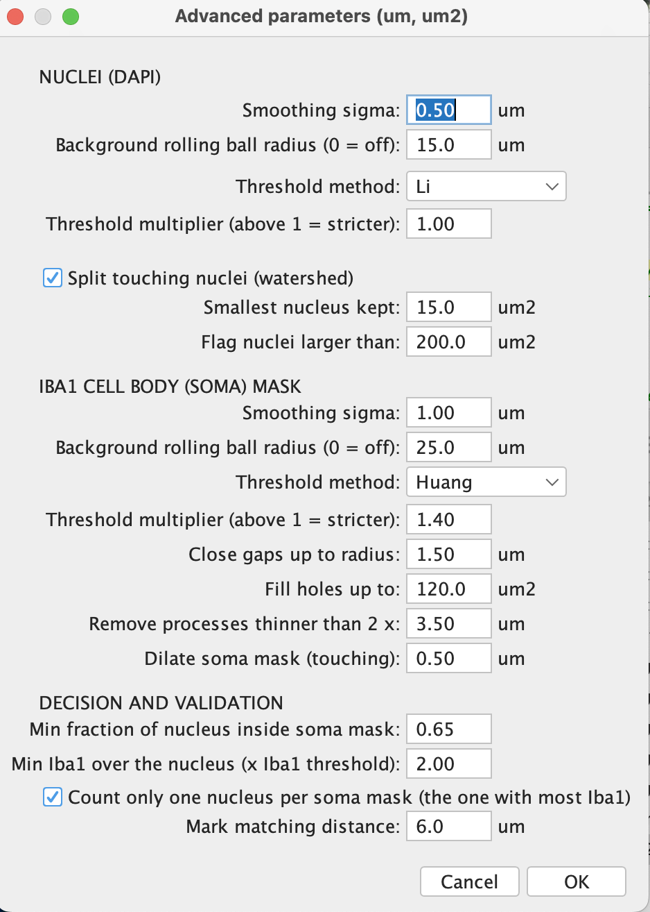

| Group | Setting | Default | What it does |
| ----- | ------- | ------- | ------------ |
| Nuclei (DAPI) | Smoothing sigma | 0.5 um | Blur before thresholding |
| | Background rolling ball radius | 15 um | Removes uneven background (0 = off) |
| | Threshold method | Li | Automatic threshold for nuclei |
| | Threshold multiplier | 1.00 | Multiplies the automatic threshold. Above 1 is stricter |
| | Split touching nuclei (watershed) | on | Separates touching nuclei |
| | Smallest nucleus kept | 15 um^2 | Smaller particles are ignored |
| | Flag nuclei larger than | 200 um^2 | Large nuclei are flagged as possible merged nuclei |
| Iba1 cell body (soma) mask | Smoothing sigma | 1.00 um | Blur before thresholding |
| | Background rolling ball radius | 25 um | Keep larger than a soma (0 = off) |
| | Threshold method | Huang | Automatic threshold for Iba1 |
| | Threshold multiplier | 1.40 | Above 1 is stricter |
| | Close gaps up to radius | 1.50 um | Closes gaps in the Iba1 ring around a nucleus |
| | Fill holes up to | 120 um^2 | Fills the hole a nucleus makes in the Iba1 ring |
| | Remove processes thinner than 2 x | 3.50 um | Opening step that leaves the somata and removes thin processes |
| | Dilate soma mask (touching) | 0.50 um | Lets a nucleus that touches a soma count |
| Decision and validation | Min fraction of nucleus inside soma mask | 0.65 | `Min_overlap` |
| | Min Iba1 over the nucleus (x Iba1 threshold) | 2.00 | `Iba1_k` |
| | Count only one nucleus per soma mask | on | Keeps the nucleus with the most Iba1 |
| | Mark matching distance | 6.0 um | How close a mark must be to a nucleus to match |

#### Marking cells for validation

In single image mode with **"Mark cells now"**, click once on every microglia in the region you want to validate (a cell with a DAPI nucleus inside or touching an Iba1 cell body). If you use ROIs, mark only inside them. Then click OK. The marks are saved to `NAME_marks.csv` next to the image so they can be reused in later runs and in batch mode.

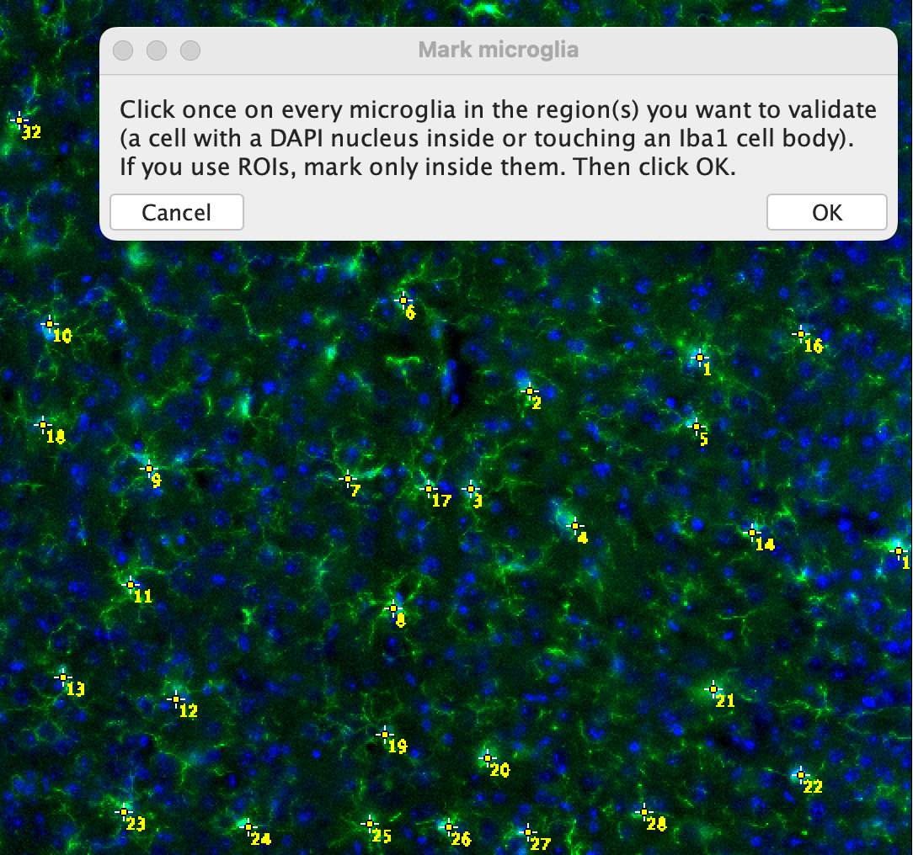

#### Method

1.  **Nuclei:** smooth, subtract background, auto threshold, fill holes, optional watershed to split touching nuclei, size filter.
2.  **Iba1 cell bodies:** smooth, subtract background, auto threshold, close small gaps, fill small holes (a nucleus is a hole in the Iba1 ring), open to remove thin processes (leaves somata), dilate slightly so "touching" counts.
3.  **Decision for each nucleus:** it is counted as a microglia when enough of its area lies inside the soma mask (`Soma_overlap` at or above `Min_overlap`) AND the Iba1 signal over the nucleus is high enough (`Iba1_on_nucleus` at or above `Iba1_k` x the Iba1 threshold). A nucleus enclosed by Iba1 processes but with no Iba1 signal on it is rejected. Optionally only one nucleus per connected soma mask is kept (the one with the highest Iba1); the others are listed with `Reason = Shared_soma`.
4.  Counts per region, area (mm^2) and density (cells/mm^2).

#### Limits

- A max projection can merge nuclei at different depths, and a microglia whose nucleus is not in the DAPI projection cannot be counted.
- Only the first time point is used for time series.

   ### CountMicroglia details: results and how to interpret them

#### Output files (folder `CountMicroglia_output`)

| File | Contents |
| ---- | -------- |
| `CountMicroglia_Summary.csv` | One row per image and region (batch) |
| `NAME_summary.csv` | Same, in single image mode |
| `NAME_nuclei.csv` | One row per nucleus (area, soma overlap, class, reason, region) |
| `NAME_QC.png` | The QC image (see below) |
| `NAME_nucmask.tif`, `NAME_somamask.tif` | Nucleus and soma masks (optional) |
| `CountMicroglia_Settings.txt` | All parameters used |

#### The QC image

The QC image shows Iba1 in green and DAPI in blue, with every nucleus outlined and numbered. The legend is written at the top of the image.

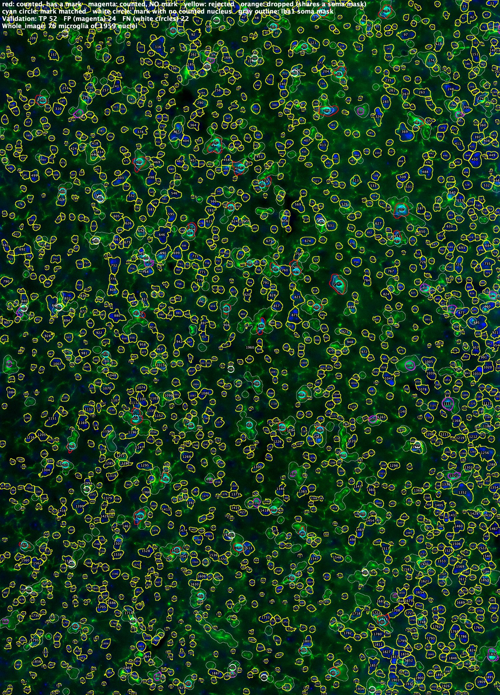

| Mark | Meaning |
| ---- | ------- |
| Red outline | Counted as microglia, and you marked it |
| Magenta outline | Counted as microglia, but you did not mark it (false positive, FP) |
| Yellow outline | Rejected (not counted as microglia) |
| Orange outline | Dropped because it shares a soma mask with a nucleus that has more Iba1 |
| Gray outline | Iba1 soma mask |
| Cyan circle | A mark that matched a counted nucleus (true positive, TP) |
| White circle | A mark with no counted nucleus (false negative, FN) |

The header reports the validation result. In this example it reads **TP 52, FP 24, FN 22** and **76 microglia of 1959 nuclei** in the whole image.

#### The mask images

Check both masks before trusting the counts.

**Nucleus mask** (`NAME_nucmask.tif`). Each white shape should be one nucleus. Thin dark lines inside a white blob are the watershed cuts that separate touching nuclei. Look for nuclei that are merged into one blob (they are flagged in `Large_nuclei_flagged`), nuclei that are missing, and background specks that are counted as nuclei.

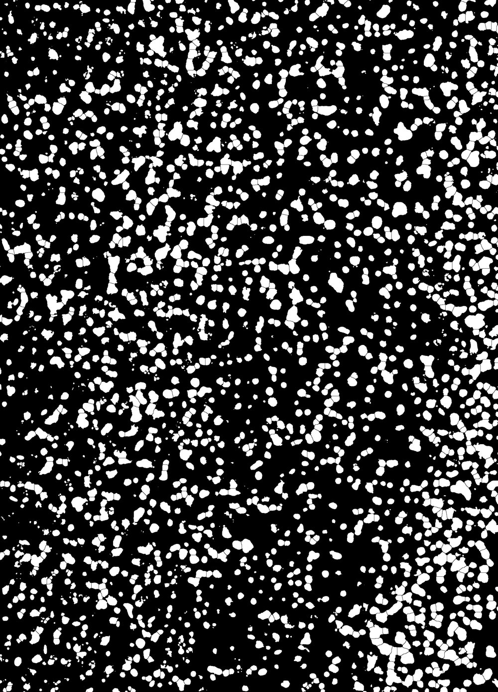

**Soma mask** (`NAME_somamask.tif`). The white shapes should be the Iba1 cell bodies, with the thin processes removed. A microglia is only counted if its nucleus overlaps this mask, so a soma that is missing here cannot be counted, and a blob that covers several nuclei can lead to nuclei being dropped as `Shared_soma`.

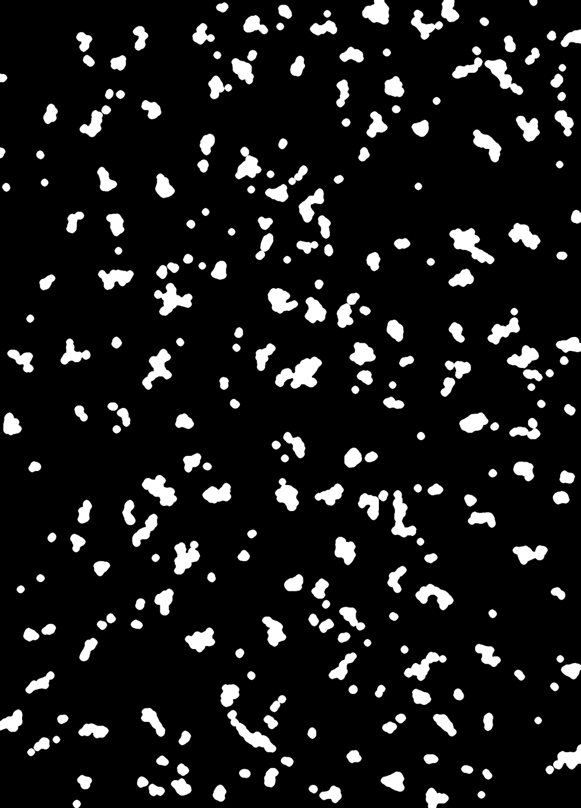

#### The summary table

One row per image and region. The columns to read first:

| Column | Meaning |
| ------ | ------- |
| `Region_area_mm2` | Area analyzed |
| `Nuclei_total` | All nuclei found in the region |
| `Microglia_count` | Nuclei counted as microglia |
| `Other_nuclei` | Nuclei not counted as microglia |
| `Microglia_per_mm2`, `Nuclei_per_mm2` | Densities |
| `Pct_nuclei_microglia` | Microglia as a percentage of all nuclei |
| `Large_nuclei_flagged` | Nuclei larger than the flag size (possible merged nuclei) |
| `Dropped_shared_soma` | Nuclei dropped because they share a soma mask |
| `Min_overlap`, `Iba1_k`, `One_per_soma`, `Nuc_threshold`, `Iba1_threshold` | Settings and thresholds used |
| `Marks`, `TP`, `FP`, `FN` | Validation counts (when you marked cells) |
| `FN_nucleus_rejected` | Missed cells where a nucleus was found but rejected |
| `FN_no_nucleus` | Missed cells where no nucleus was found at all |
| `Precision`, `Recall`, `F1` | See below |
| `Warnings` | Messages from the run, such as a missing pixel size |

The nuclei table (`NAME_nuclei.csv`) has one row per nucleus. `Class` is Microglia or Other, and `Reason` says why: `Microglia`, `Low_soma_overlap`, `Low_Iba1_on_nucleus` or `Shared_soma`. It also has `Soma_overlap`, `Iba1_on_nucleus`, `Iba1_ratio` (Iba1 over the nucleus divided by the Iba1 threshold) and `Large_flag`.

#### Validation measures

- **Precision** = TP / (TP + FP). How many of the counted microglia are real. A low value means too many false positives.
- **Recall** = TP / (TP + FN). How many of the cells you marked were counted. A low value means missed microglia.
- **F1** = 2 x TP / (2 x TP + FP + FN). A single score that balances both. Use it to compare settings.

In the example above, TP 52, FP 24 and FN 22 give 74 marked cells, precision 0.68, recall 0.70 and F1 0.69. Errors are split about evenly between false positives and missed cells, so look at `FN_nucleus_rejected` and `FN_no_nucleus` and at the `Reason` column to see what to change.

   ### CountMicroglia details: tuning the settings before the full batch

Change **one setting at a time**, re-run on the same test image with the same marks, and compare F1, precision and recall. Always look at the QC image and masks as well as the numbers.

#### Step 1: check the nuclei

Open the nucleus mask and QC image. If nuclei are wrong, fix this first because every later step depends on it.

| What you see | What to change |
| ------------ | -------------- |
| `FN_no_nucleus` is high: marked cells have no nucleus outline | Lower the nucleus threshold multiplier (below 1 is more permissive), reduce the nucleus background radius or smoothing, or lower "Smallest nucleus kept". Also check that the DAPI channel number is right |
| Background specks outlined as nuclei | Raise the nucleus threshold multiplier or raise "Smallest nucleus kept" |
| Touching nuclei fused into one blob (`Large_nuclei_flagged` is high) | Make sure "Split touching nuclei" is ticked. Raise the nucleus threshold multiplier slightly, or lower the smoothing sigma |
| One nucleus cut into pieces | Raise the smoothing sigma or turn off splitting |

#### Step 2: check the Iba1 soma mask

Open the soma mask. It should cover the cell bodies and not the processes.

| What you see | What to change |
| ------------ | -------------- |
| Somata missing from the mask | Lower the Iba1 threshold multiplier, or lower "Remove processes thinner than 2 x" |
| Mask covers processes and fibres as well as somata | Raise the Iba1 threshold multiplier, or raise "Remove processes thinner than 2 x" |
| Several neighboring cells merged into one blob | Raise "Remove processes thinner than 2 x", or lower "Close gaps up to radius" |
| Nuclei with Iba1 around them are not inside the mask | Raise "Fill holes up to" or "Close gaps up to radius", or raise "Dilate soma mask" |

#### Step 3: tune the decision rule

Use the `Reason` column in `NAME_nuclei.csv` and the `FN_nucleus_rejected` column to see why marked cells were rejected.

| What you see | What to change |
| ------------ | -------------- |
| Marked cells rejected with `Low_soma_overlap` | Lower **Min fraction of nucleus inside soma mask** (for example 0.65 to 0.5), or increase "Dilate soma mask" |
| Marked cells rejected with `Low_Iba1_on_nucleus` | Lower **Min Iba1 over the nucleus** (for example 2.0 to 1.5). Check `Iba1_ratio` for the missed cells to pick a value |
| Marked cells dropped as `Shared_soma` | Two nuclei share one soma mask. If they are really two cells, untick "Count only one nucleus per soma mask" or split the soma mask (raise the opening size). If one is a neighbor, leave it on |
| Many magenta outlines (counted but not marked) | Check them against the image. If they are not microglia, raise Min fraction inside soma mask, raise Min Iba1 over the nucleus, or raise the Iba1 threshold multiplier. If they are real microglia you did not mark, add marks and re-run |
| Many white circles with no outline (FN, `FN_no_nucleus`) | Go back to Step 1, nuclei were not found |
| Marks miss only because they are slightly off the nucleus | Increase the mark matching distance |

A general rule: **raising** Min overlap, Min Iba1 or the Iba1 multiplier makes counting stricter (fewer false positives, more misses). **Lowering** them makes it more permissive (fewer misses, more false positives). Stop when precision and recall are both acceptable for your question.

#### Step 4: confirm before the batch

1.  Re-run with the final settings and note the F1.
2.  Test on two or three more images that differ in staining, brightness or region. Mark a smaller region in each. If F1 drops a lot, the settings are too specific to the first image.
3.  Check `CountMicroglia_Settings.txt` to confirm what was used.
4.  Turn validation off and run **batch** mode on the whole folder. Check the `Warnings` column in `CountMicroglia_Summary.csv` and look at a few QC images from the batch.
5.  Use the same settings for every image in a comparison so that counts are comparable across groups.

